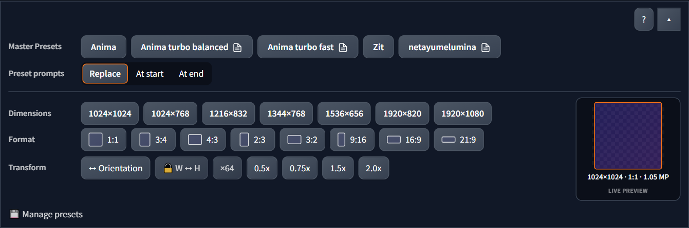
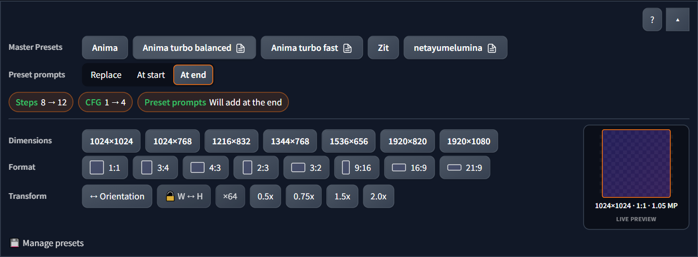
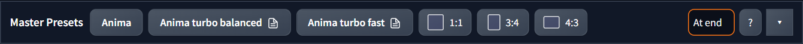

# Master Presets for Forge UI Neo

One-click working presets for Forge UI Neo with integrated Quick Dimensions.

## Screenshots

*The panel: saved prompt indicators, prompt modes, quick dimensions, formats, transform controls and a live size preview.*

*Hovering a preset previews exactly what applying it will change (`was → will be`), down to the checkpoint.*

*The quick bar shows your first presets and formats and the current prompt mode.*

## Requirements

- Forge UI Neo, `neo` branch (tested at tag `2.31` with the commits on top of it at the time of writing; other versions were not tested).
- Developed and tested in a Chromium-based browser; other browsers were not tested.

## Install

1. Download the install ZIP from the GitHub release and extract it into Forge Neo’s `extensions/` folder so that `scripts/`, `javascript/` and `style.css` end up in `extensions/master-presets-forge-neo/`.
2. Restart Forge Neo. If the panel does not appear, use Settings → Actions → "Reload custom script bodies (No ui updates, No restart)" and hard-refresh the page (Ctrl+F5).
3. The panel shows up in the txt2img and img2img tabs under the generation parameters.

Your presets live in `master_presets.json` inside the extension folder. The file is created on first save and is intentionally not part of the repository or the release ZIP.

### Optional example presets

Download [master-presets-examples.json](master-presets-examples.json) from the repository or get it as a separate release asset. In Forge Neo, open **Master Presets → Manage presets → Import** and select the JSON file.

The examples include five presets with their original model references, seven quick sizes, and the preset and format order. Import merges them with your existing settings and replaces any presets with the same names. The examples require their listed checkpoints and, where applicable, VAEs or text encoders. If Forge Neo cannot select a required checkpoint, Master Presets reports its name so you can install the model and refresh the checkpoint list.

## Master Presets

A Master Preset restores the model setup and generation parameters: UI Preset, Checkpoint, VAE / Text Encoders, Low Bits mode, Width / Height, Steps, CFG, Distilled CFG, Sampler, Scheduler, Styles, Seed, the Hires. fix block (enable, upscaler, steps, denoising, scale — txt2img), and optionally prompts.

- Click a preset to apply it.
- Fields that already match the current setup are left untouched, including VAE / Text Encoders.
- Seed is stored as-is: `-1` keeps the generation random, a number pins it.
- The Hires. fix block is applied as a whole (checkbox, upscaler, steps, denoising, scale).
- Presets saved before Seed / Hires. fix support do not touch those fields until re-saved under the same name.
- A document icon marks presets with saved prompts in both the full and collapsed panels. Use **Preset prompts** to replace the current text or add the saved text at the start or end. The setting is remembered separately for txt2img and img2img. The hover card reflects the selected mode.
- If the checkpoint cannot be selected, the error names it and stops the preset before applying the saved generation settings or prompts.
- To delete a preset, turn on **Edit buttons** and click its red trash button. Preset deletion asks for confirmation.

### Preset preview on hover

- Hovering a preset shows, in the detail card, only what applying it would change relative to the current UI of this tab: `was → will be`. An empty diff reads "Matches current settings"; prompt differences appear as one chip that describes the active prompt mode.
- Hovering the selected preset shows its full settings — while they still match the live UI. Once the current setup drifts from it (for example the UI Preset was switched in Forge), the card shows the same `was → will be` diff until the preset is applied again.
- The card is visible only while hovering — nothing stays pinned. It appears after a short dwell (500 ms) so crossing the button row does not flash it.
- The collapsed quick bar follows the same rules: hovering a preset there shows the same detail card — the `was → will be` diff for other presets; the selected one shows full settings while they match, the diff when they drift.

## Quick Dimensions

The same panel includes quick image-size controls:

- saved exact sizes with optional custom names
- Remove saved quick sizes with the red trash button in **Edit buttons** mode
- restore the size stored in the selected Master Preset
- swap orientation with one button
- aspect-ratio buttons: 1:1, 4:3, 3:4, 3:2, 2:3, 16:9, 9:16, 21:9, with proportional mini-icons and tooltips
- link Width and Height to keep the current aspect ratio
- optional ×64 mode so automatic size changes remain divisible by 64
- scale the current size by 0.5x, 0.75x, 1.5x, or 2.0x
- live preview: a square card on the right with a proportional frame that morphs as the size changes (it also follows the main Width / Height sliders), showing `Width × Height · ratio · megapixels`

Aspect-ratio buttons keep approximately the same image area, so changing from square to widescreen does not unnecessarily reduce the total resolution. When ×64 is active, generated dimensions are rounded to multiples of 64; otherwise they are rounded to multiples of 8.

To give a quick size a readable name, enter an optional label before clicking `Save size`. Saving an existing Width × Height with a new label renames that quick-size button.

## Switching across UI Presets

Applying a preset changes the Forge Neo **UI Preset and Checkpoint even when you are currently on a different UI Preset** (for example jumping from `zit` to `anima`). Gradio 4.40 Dropdown is a Svelte component: assigning `input.value` does not update it. The extension therefore opens the actual dropdown and selects the real `li[data-testid="dropdown-option"]` element through the same `mousedown` event used by Gradio. It waits for Forge Neo's preset callback to settle before selecting the checkpoint and applying the remaining parameters. No page reload is needed.

Note: after a browser restart the dropdowns may display the values stored in the saved config while the server still has a different checkpoint loaded. If a generation comes out with the wrong model, apply the preset once more (or pick any other preset and back) to force a real switch.

## Architecture and maintenance

- `javascript/bridge.js` is the only place that talks to the Gradio/Svelte DOM: value reading, native setters, Svelte dropdown selection, UI-preset settle waits, checkbox access. It must load before `master_presets.js` (Forge loads extension scripts alphabetically) and its API is frozen; UI, state and rendering live in `master_presets.js` and consume it through `window.MasterPresetsBridge`.
- `TESTING.md` holds a short manual smoke checklist; the extension is verified in a live Forge, not by automated tests.
- Forge computes the extension script list once at server start. A **new** `.js` file in `javascript/` appears on the page only after Settings → Actions → "Reload custom script bodies (No ui updates, No restart)" plus a page reload. **Changed** contents of existing files need a hard refresh (Ctrl+F5).
- The panel is collapsible per tab.

## Updating

The release ZIP intentionally does not contain `master_presets.json`. Extract it over the existing `master-presets-forge-neo` folder and replace the extension files. Saved presets and quick sizes are not overwritten.

## Quick bar, edit mode and help

- The collapsed panel keeps a one-line quick bar with the panel title on the left: your first 3 presets and first 3 formats (drag them to the front in edit mode to change what shows there).
- The **Edit buttons** button in the Manage presets section toggles edit mode: presets, formats and sizes become draggable to reorder, and presets, saved sizes and custom formats get a red trash button for deletion. Format order and preset order are stored on the server (`presetOrder`, `formatOrder`).
- Preset buttons sit on a labeled row: the Master Presets label shares the label column with Dimensions, Format and Transform. In the expanded panel the header holds only the ? and collapse buttons; the title shows in the header only while the panel is collapsed.
- Edit buttons and Export / Import sit at the bottom of the Manage presets section; the two name inputs have equal widths. Export / Import carry the preset and format order plus custom format names, so a JSON round-trip restores the whole layout.
- The ? button (top right) opens a short how-to.

### Custom formats

Save the current size as a named aspect ratio with `Save as format` (next to `Save size`). The ratio is normalized (1344×768 → 7:4 if not one of the built-ins), applying it keeps the current pixel area like any other format. Custom formats get names from the size-name field, are draggable in edit mode and deletable with their trash button; built-in ratios stay fixed.

## License

[MIT](LICENSE).
